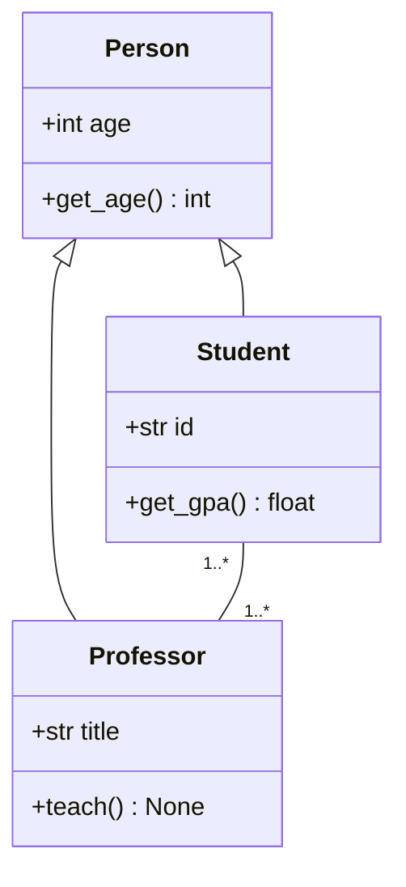

# Student-Class-Implementation

A Python example demonstrating object-oriented inheritance with `Person` as the base class and `Student` and `Professor` as subclasses.

## Classes & Methods
- **`Person(age)`**: Stores `age` and provides `get_age()`.
- **`Student(age, id)`**: Inherits from `Person`, stores `id`, and provides `get_gpa()` (returns `0.0`).
- **`Professor(age, title)`**: Inherits from `Person`, stores `title`, and provides `teach()`.

## Usage
```bash
python3 main.py

## Diagram

